# claude-mods

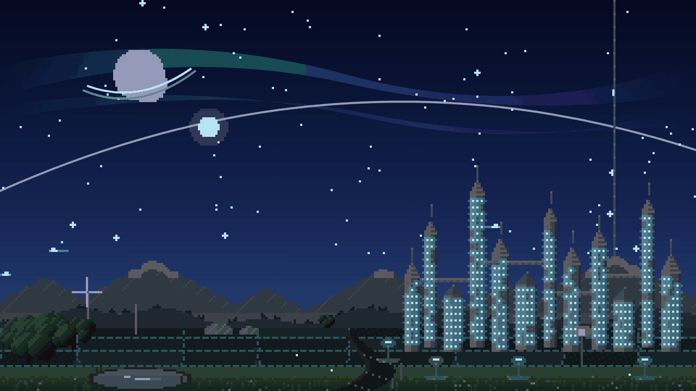

Mods for [Claude Code](https://claude.com/claude-code) that make a long session nicer to live in:
a pixel-art world behind the conversation that reacts to what Claude is doing, a pixel system
monitor above the prompt, a receipt under every reply, and a pane for the replies worth keeping.
Each one installs on its own.

**Docs:** [guhan-sensam.github.io/claude-mods](https://guhan-sensam.github.io/claude-mods/) ·
**For AI agents:** [llms.txt](https://guhan-sensam.github.io/claude-mods/llms.txt)

| Mod | What it does |
|---|---|
| [**thinking-weather**](plugins/thinking-weather) | A pixel-art valley behind the conversation. Storms roll in while Claude works, every tool call strikes lightning, and society advances from the Stone Age to a sci-fi city as the context fills, then resets when it is compacted. Follows the clock, the seasons and your town's real weather. |
| [**system-monitor**](plugins/system-monitor) | Pixel-art CPU, RAM and GPU meters above the prompt, lit for the time of day; `/sysmon` opens a detail pane. |
| [**turn-receipt**](plugins/turn-receipt) | A one-line receipt under each finished reply: time taken, tool calls, agents, files edited, tokens. |
| [**pins**](plugins/pins) | Pin replies into a Pinned pane you can come back to, from the desktop or your phone. |

## thinking-weather

The background tells you what the session is doing without reading a word of it.

| | |
|---|---|
| 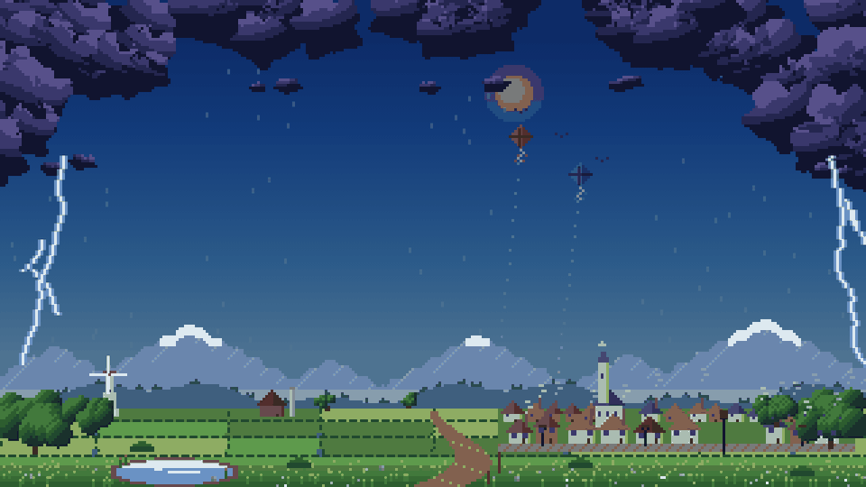 | 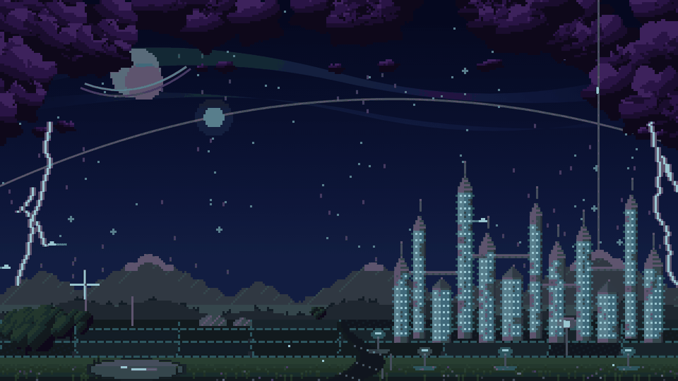 |
| **Claude working:** storm clouds glide in, rain falls once they arrive, and every tool call or slash command strikes lightning. A failed call strikes red; each subagent flies a kite. | **The future's storm:** in the sci-fi era the storm is an ion storm, with violet clouds and neon lightning. |

**Society follows the context.** A fresh conversation is a Stone Age settlement. Society moves
up an era for each fifth of the context window, and near a full context the valley is a sci-fi
city. When the conversation is compacted, fog rolls in and society falls back to the Stone Age
behind it.

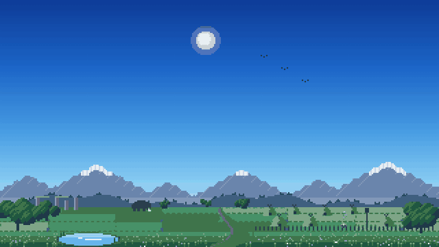

**The world outside.** The sky follows your local clock, with dawn and dusk at your town's real
sunrise and sunset and the moon in its real phase. The land follows the seasons. Set a town and the
idle sky follows its real weather: clear, a few clouds, overcast, rain, snow, fog or thunder.

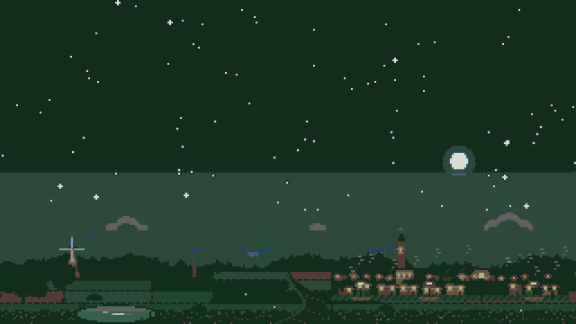

| | | |
|---|---|---|
| 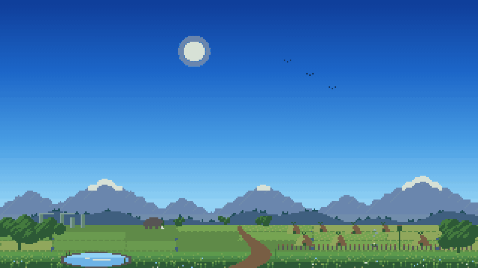 | 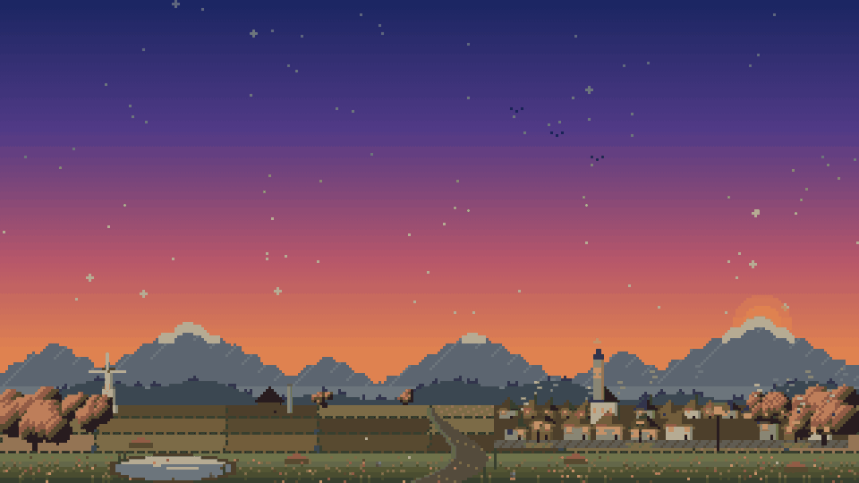 | 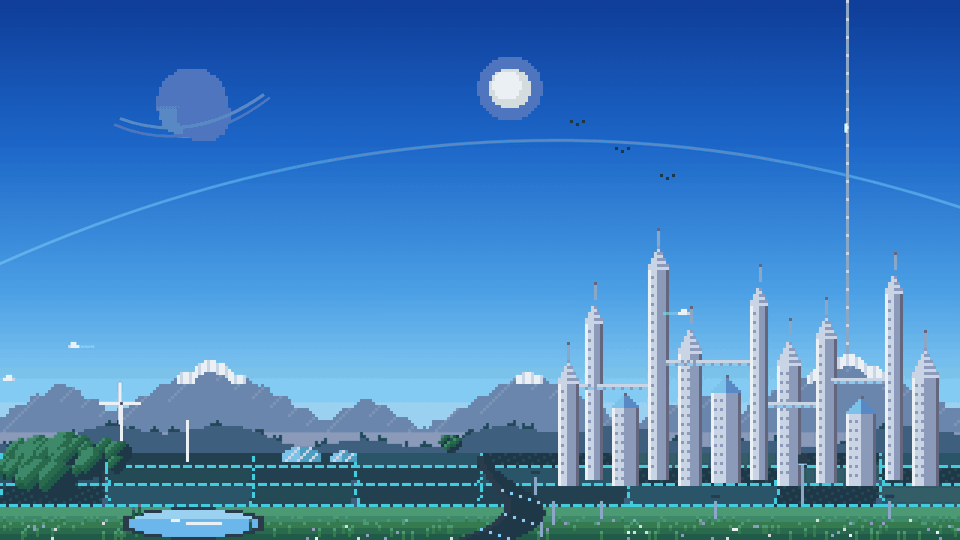 |
| 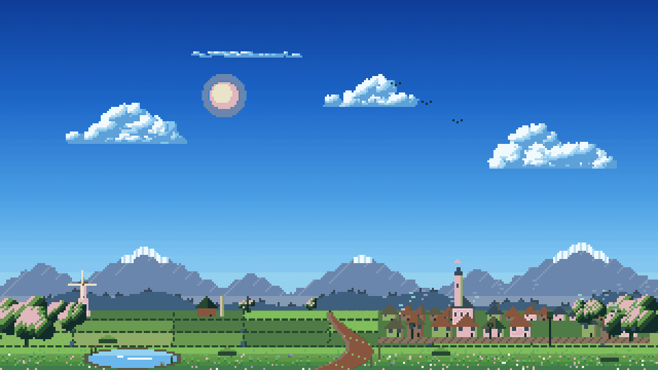 | 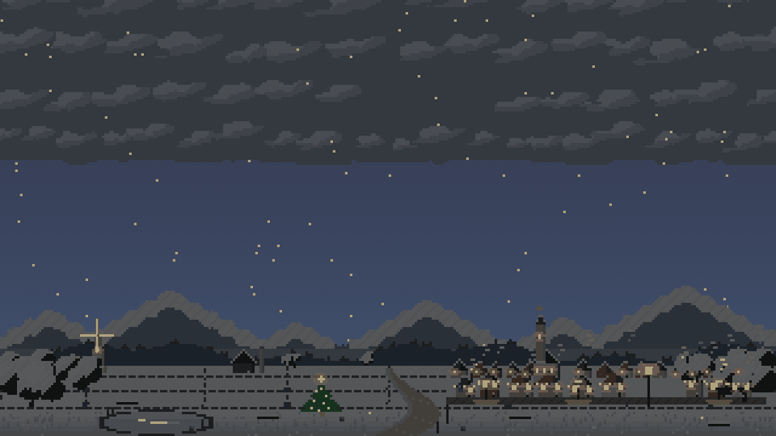 | 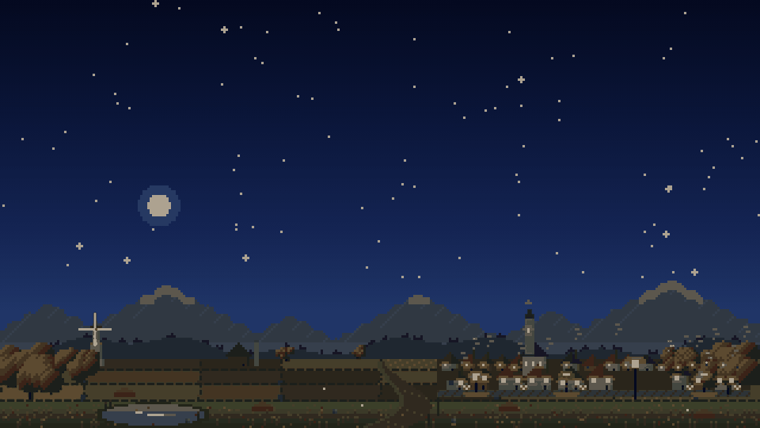 |

It also marks git commits with fireworks, compaction with fog, and Halloween, December, New Year's
Eve and the Fourth of July with decorations. On the desktop the working row becomes a little pixel
storm cloud. Everything is vector pixel art drawn live, so it stays sharp at any window size.
[Full guide](plugins/thinking-weather/README.md).

## system-monitor


A band above the prompt with a chip, a memory stick and a graphics card, each followed by a
game-style bar in the weather scene's colours: green, then gold from 70%, then lantern orange from
90%. It warms at dusk and dims at night. The terminal shows text bars instead. `/sysmon` opens a
pane with threads, load, memory, swap, VRAM and GPU temperature.
[Full guide](plugins/system-monitor/README.md).

## turn-receipt

```
4m 12s · 23 tool calls · 2 agents · edited register.tsx, sample.ts +4 · 3.2k tokens out
```

A receipt under each finished reply, so you can see at a glance which turns did real work.
[Full guide](plugins/turn-receipt/README.md).

## pins

Hover a reply on the desktop and press **Pin**, or type `/pin` on your phone. Pinned replies stay
in a Pinned pane, newest first, and come back when you reopen any of your last 30 sessions.
[Full guide](plugins/pins/README.md).

## Install

They need a Claude Code with mods (built and tested on 2.1.325). Backgrounds and the pixel band
draw in the desktop app; the terminal shows the text parts.

**In the desktop app:** click **+** next to the prompt box, then **Plugins**, **Add marketplace**
with `Guhan-SenSam/claude-mods`, then **Add plugin** and pick a mod.

**At a terminal prompt:**

```
/plugin install thinking-weather --marketplace Guhan-SenSam/claude-mods
```

**From a shell:**

```bash
claude plugin install thinking-weather --marketplace Guhan-SenSam/claude-mods
```

Pick the user scope to have a mod in every session. To update: `claude plugin update <mod>`.

## Privacy

Everything runs on your machine. The one exception is thinking-weather's real weather, which is
off until you set a town: then it asks [Open-Meteo](https://open-meteo.com) for the weather every
30 minutes, sending the town's name once and afterwards only its coordinates rounded to about
10 km. system-monitor reads `/proc` and `nvidia-smi` locally and sends nothing.

## Develop

Each mod lives in `plugins/<name>/` with its own README and tests:

```bash
claude plugin validate plugins/<name>
claude plugin test plugins/<name>
```

thinking-weather's art is generated: `python3 plugins/thinking-weather/tools/gen_art.py
plugins/thinking-weather /tmp/preview` (numpy and pillow) rewrites `hooks/art.ts`. See
[AGENTS.md](AGENTS.md) for how the repository is laid out and the pitfalls to avoid.

## Credits

thinking-weather draws its pixel art as vector runs after the method of
[BackdropKit](https://github.com/winchxyz/backdropkit) (MIT), whose scenes inspired the look.

## License

MIT
